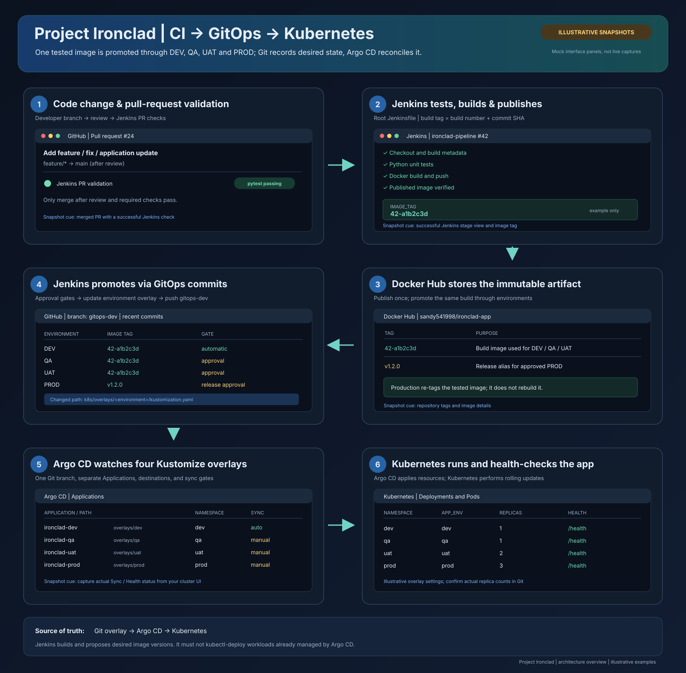

# Project-Ironclad-Pipeline

Automated GitOps CI/CD pipeline featuring PR validation, immutable Docker image promotion (DEV/QA/UAT), semantic versioning, and zero-downtime rolling updates using Kubernetes.

## 📋 Overview

Project Ironclad is an end-to-end DevOps CI/CD pipeline implementation demonstrating enterprise-grade practices for continuous integration, delivery, and deployment. It showcases automated testing, Docker containerization, Docker Hub image management, and Kubernetes-based orchestration across multiple environments.

## 🛠 Technology Stack

- **Version Control**: GitHub
- **CI/CD Automation**: Jenkins
- **Containerization**: Docker
- **Container Registry**: Docker Hub
- **Orchestration**: Kubernetes (Minikube)
- **Application**: Flask (Python 3.12)
- **Testing**: pytest

## 🏗 Architecture

```
Developer
    ↓
Feature Branch
    ↓
Pull Request
    ↓
PR Validation (Automated Tests)
    ↓
Code Review & Merge to Main
    ↓
Jenkins Tests, Builds & Pushes Image
    ↓
Jenkins Updates DEV Overlay on gitops-dev
    ↓
Argo CD Syncs DEV
    ↓
QA/UAT Approval → Jenkins Updates Environment Overlay → Argo CD Syncs
    ↓
Production Release Approval → PROD Overlay Update → Argo CD Syncs
```

## 📁 Project Structure

```
Project-Ironclad-Pipeline/
├── app/                           # Flask application
│   ├── app.py                     # Main Flask application
│   ├── test_app.py               # Unit tests
│   ├── requirements.txt           # Python dependencies
│   └── Dockerfile                # Application container image
├── jenkins/                       # Jenkins pipeline definitions
│   ├── pr-validation.groovy      # Pull request validation pipeline
│   └── deploy-kustomize-pipeline.groovy # Alternative scripted GitOps pipeline
├── argocd/                        # Argo CD Application definitions
│   ├── ironclad-dev.yaml
│   ├── ironclad-qa.yaml
│   ├── ironclad-uat.yaml
│   └── ironclad-prod.yaml
├── k8s/                          # Kubernetes manifests
│   ├── base/                     # Shared Deployment and Service
│   └── overlays/                 # DEV, QA, UAT and PROD Kustomize configuration
├── docs/                         # Documentation
│   └── git-workflow.md          # Git workflow documentation
├── Jenkinsfile                  # Main build, promotion and GitOps pipeline
├── Jenkinsfile.pr-validation    # PR validation pipeline definition
└── README.md                    # This file
```

## 🚀 Getting Started

### Prerequisites

- GitHub account with repository access
- Jenkins server configured with Git and Docker plugins, Kustomize CLI, plus Docker Hub and GitHub credentials
- Docker and Docker Hub account
- kubectl configured to access Kubernetes cluster (Minikube for local development)
- Python 3.12+ (for local testing)

### Local Setup

1. **Clone the repository**
   ```bash
   git clone https://github.com/<your-org>/Project-Ironclad-Pipeline.git
   cd Project-Ironclad-Pipeline
   ```

2. **Set up Python environment**
   ```bash
   python3 -m venv venv
   source venv/bin/activate  # On Windows: venv\Scripts\activate
   ```

3. **Install dependencies**
   ```bash
   pip install -r app/requirements.txt
   ```

4. **Run tests locally**
   ```bash
   cd app
   pytest -v
   cd ..
   ```

5. **Run the application locally**
   ```bash
   python app/app.py
   ```
   The application will be available at `http://localhost:5000`

## 🔄 CI/CD Pipeline Workflows

### 1. Pull Request Validation
- **Trigger**: When a PR is created against `main` branch
- **Pipeline**: `Jenkinsfile.pr-validation`
- **Steps**:
  - Checkout code
  - Run automated tests
  - Generate build metadata
  - Validate code quality
  - Post results to PR

### 2. Main Build Pipeline
- **Trigger**: On application-source branch updates, as configured in Jenkins
- **Pipeline**: `Jenkinsfile`
- **Steps**:
  - Checkout code
  - Get build metadata (build number, git commit SHA)
  - Run test suite
  - Build Docker image
  - Push to Docker Hub
  - Update the DEV Kustomize image tag on the `gitops-dev` branch

### 3. Progressive Deployment
After successful image publication, Jenkins advances the same image through environments:
- **DEV**: GitOps tag updated automatically; Argo CD auto-syncs the DEV Application
- **QA/UAT**: Jenkins approval, then GitOps tag update; manually sync the Argo CD Application initially
- **PROD**: Release approval and semantic image tag, then GitOps tag update; manually sync the Argo CD Application initially

Configure the Jenkins job to use the root `Jenkinsfile` and exclude the `gitops-dev` branch from build triggers to avoid a build loop.

## 🌳 Git Workflow

### Branch Strategy

- **`main`**: Production-ready code, protected branch
- **`feature/<feature-name>`**: Feature branches for development

### Creating a Feature Branch

```bash
git checkout -b feature/new-endpoint
```

### Committing Changes

```bash
git add .
git commit -m "add new API endpoint"
```

### Pushing and Creating PR

```bash
git push origin feature/new-endpoint
```
Then create a Pull Request on GitHub for code review.

### Merging

After PR approval and tests pass, merge to `main` branch. CI/CD pipeline automatically triggers.

## 📊 Environments

| Environment | Purpose | Deployment Type | Users |
|-------------|---------|-----------------|-------|
| **DEV** | Development & testing | Automatic on build | Developers |
| **QA** | Quality assurance | Automatic after DEV | QA Team |
| **UAT** | User acceptance testing | Automatic after QA | Business Users |
| **PROD** | Production/Live | Manual approval | End Users |

## 🐳 Docker

### Building Locally

```bash
docker build -t ironclad-app:latest app/
```

### Running Docker Container

```bash
docker run -p 5000:5000 -e APP_ENV=dev ironclad-app:latest
```

### Image Details

- **Base Image**: `python:3.12-slim`
- **Registry**: Docker Hub (`sandy541998/ironclad-app`)
- **Tagging**: `{BUILD_NUMBER}-{GIT_COMMIT_SHORT}`

## ☸️ Kubernetes

### Application Endpoints

- **Health Check**: `GET /health`
- **Status**: `GET /`

### Key Features

- **Replicas**: 2 pods for high availability
- **Rolling Updates**: Zero-downtime deployments (maxUnavailable: 1, maxSurge: 1)
- **Revision History**: Maintains last 5 deployments for quick rollback
- **Termination Grace Period**: 30 seconds for graceful shutdown

### Argo CD GitOps deployment

The `gitops-dev` branch is the desired-state branch watched by all four Argo CD Applications. Each environment has a Kustomize overlay under `k8s/overlays/`. Jenkins builds and pushes an immutable image, then updates only the promoted environment's `newTag` in that branch. QA, UAT and PROD updates remain behind the corresponding Jenkins approval stages. DEV auto-syncs; QA, UAT and PROD Applications are configured for manual sync initially, so creating them or changing their Git tags cannot unexpectedly promote a release. Review the Argo CD diff and sync each environment after its Jenkins approval. Argo CD reconciles the cluster from Git; Jenkins must not run `kubectl apply`, `kubectl set image`, or rollout commands for Argo CD-managed workloads.

Apply the Application definitions once using a kubectl context that can access the cluster:
```bash
kubectl apply -f argocd/ironclad-dev.yaml
kubectl apply -f argocd/ironclad-qa.yaml
kubectl apply -f argocd/ironclad-uat.yaml
kubectl apply -f argocd/ironclad-prod.yaml
```

Before applying the QA/UAT/PROD Applications, set each overlay's initial `newTag` to the version currently intended for that environment, and inspect its Argo CD diff before syncing. Before running the deployment pipeline, ensure the `gitops-dev` branch contains the `k8s/overlays/` files and all four Application source paths. Configure Jenkins credentials `github-ssh` (SSH write access for GitOps updates), `sandeep-token` (release-tag push), and `dockerhub`, and configure the Jenkins job to build only application-source branches so GitOps commits do not trigger another image build.

## 🧪 Testing

### Unit Tests

```bash
cd app
pytest -v
```

### Test Coverage

Tests are automatically run in Jenkins during:
- PR validation
- Main branch builds

## 📝 API Endpoints

### Home Endpoint
```
GET /
```
Returns application metadata:
- Application name
- Version
- Environment
- Hostname
- Status

### Health Check
```
GET /health
```
Returns health status (used by Kubernetes liveness/readiness probes)

## 🔐 Security Practices

- Non-root user in Docker container (`appuser`)
- Read-only filesystem where applicable
- Proper secret management through environment variables
- Network policies via Kubernetes service definitions

## 📈 Versioning

- **Docker Image Tag**: `{BUILD_NUMBER}-{GIT_COMMIT_SHORT}`
- **Application Version**: Semantic versioning in source code
- **Kubernetes Revision History**: Automatic tracking for rollbacks

## 🐛 Troubleshooting

### Jenkins Pipeline Fails
1. Check Jenkins logs for detailed error messages
2. Verify Docker Hub credentials are configured
3. Ensure Kubernetes cluster is accessible

### Deployment Issues
1. Check pod status: `kubectl get pods`
2. View logs: `kubectl logs <pod-name>`
3. Describe pod: `kubectl describe pod <pod-name>`

### Application Not Responding
1. Verify service is running: `kubectl get svc`
2. Check port forwarding is correct
3. Review application logs for errors

## 📚 Additional Documentation

- [Git Workflow Documentation](docs/git-workflow.md)
- [End-to-End Architecture Walkthrough](docs/architecture-flow.md)



## 👨‍💻 Contributing

1. Create a feature branch from `main`
2. Make your changes
3. Submit a Pull Request
4. Wait for automated tests to pass and code review
5. Merge to `main` after approval

## 📄 License

This project is part of the DevOps learning curriculum.

## 👥 Contact & Support

For questions or issues, please create an issue in the GitHub repository.