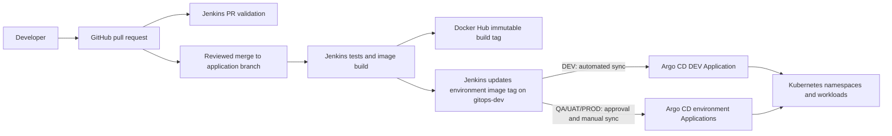

# Project Ironclad: End-to-End Architecture Flow

This walkthrough follows the project from a code change to a running workload. The accompanying [architecture-flow.svg](./architecture-flow.svg) is a presentation-friendly overview with illustrative interface snapshots.

> **Snapshot note:** The panels in the SVG are mockups for explaining the workflow. They are not screenshots captured from a live GitHub, Jenkins, Docker Hub, Argo CD, or Kubernetes installation. Sample build numbers, tags, and statuses are illustrative.

## At a glance



## Walkthrough and snapshots

### 1. Code change and pull-request checks

Developers make application changes on a feature branch and open a pull request. Jenkins uses [Jenkinsfile.pr-validation](../Jenkinsfile.pr-validation) to install Python dependencies and run the `pytest` suite before the change is merged.

**Snapshot to look for:** a GitHub pull request with Jenkins validation reported as passing. The repository's Jenkins PR pipeline validates code; it does not publish an image or deploy an environment.

### 2. Jenkins builds and tests the application

The root [Jenkinsfile](../Jenkinsfile) checks out the source, creates a version from the Jenkins build number and short Git commit, runs tests, builds the Docker image, and pushes it to Docker Hub.

Build tag format:

```text
<BUILD_NUMBER>-<GIT_COMMIT_SHORT>
Example: 42-a1b2c3d
```

**Snapshot to look for:** Jenkins stage view showing `Run Unit Tests`, `Build Docker Image`, `Push Artifact`, and `Verify Published Image` successful.

### 3. The image is published once

The pipeline publishes the build-tagged image to `sandy541998/ironclad-app`. DEV, QA, and UAT are advanced using this same image tag. For production, Jenkins retags that image with the approved semantic release version; it does not rebuild the application.

**Snapshot to look for:** the Docker Hub repository's tags list showing the build tag and, after a release, the semantic version tag.

### 4. Jenkins changes desired state in Git

After publishing the image, Jenkins checks out the `gitops-dev` branch and uses Kustomize to set the tag for the relevant environment in `k8s/overlays/<environment>/kustomization.yaml`. It verifies the rendered image, commits the change, and pushes it to `gitops-dev`.

Promotion sequence in the root Jenkinsfile:

1. DEV tag update runs after the image is published.
2. QA tag update follows the QA approval.
3. UAT tag update follows the UAT approval.
4. PROD tag update follows the release approval and semantic image retag.

**Snapshot to look for:** a Git commit on `gitops-dev` changing only the promoted environment's `newTag`, for example `k8s/overlays/qa/kustomization.yaml`.

### 5. Argo CD watches one Application per environment

Argo CD Applications point at the same repository and `gitops-dev` revision, but each watches its own overlay:

| Application | Overlay | Destination namespace | Sync mode |
|---|---|---|---|
| `ironclad-dev` | `k8s/overlays/dev` | `dev` | Automated sync with self-heal |
| `ironclad-qa` | `k8s/overlays/qa` | `qa` | Manual sync |
| `ironclad-uat` | `k8s/overlays/uat` | `uat` | Manual sync |
| `ironclad-prod` | `k8s/overlays/prod` | `prod` | Manual sync |

These settings are defined in [argocd/](../argocd). QA, UAT, and PROD changes become desired state when Jenkins pushes the Git update, but the cluster is not changed until an operator syncs that Application in Argo CD. Review the diff before syncing.

**Snapshot to look for:** the Argo CD Applications list showing the four Applications, their source paths, and sync policies. Actual health and sync statuses depend on the live cluster and should be captured from your own UI.

### 6. Kubernetes runs and monitors the application

Each overlay combines the shared resources under [k8s/base/](../k8s/base/) with its namespace, replica count, and `APP_ENV` patch. Argo CD applies the rendered resources to the matching namespace. Kubernetes pulls the image, performs a rolling update, and uses the application's `/health` endpoint for readiness and liveness probes.

**Snapshot to look for:** Kubernetes workloads/pods in the environment namespace, their running image tag, and successful readiness. For example:

```bash
kubectl get deployments,pods,services -n dev
kubectl get deployment ironclad-app -n dev \
  -o jsonpath='{.spec.template.spec.containers[0].image}{"\n"}'
```

## Operating rule

Once Argo CD manages an environment, Git is the desired-state source of truth. Jenkins updates the overlay; Argo CD reconciles it. Do not have Jenkins also run `kubectl apply`, `kubectl set image`, or `kubectl rollout undo` for the same workload. Roll back by reverting the relevant Git image-tag change and syncing it through Argo CD.

## Capture real screenshots for a live demo

The SVG is intentionally a mockup rather than an imitation of a live dashboard. To make a project-specific presentation, replace or supplement its panels with screenshots from:

1. A merged pull request and passing Jenkins PR check.
2. Jenkins' successful build and promotion stages.
3. Docker Hub's image tags.
4. The `gitops-dev` commit that changed an overlay.
5. Argo CD's Applications list and a reviewed sync diff.
6. Kubernetes pods and service in the environment namespace.

Redact credentials, tokens, private endpoints, and other sensitive values before sharing screenshots.
